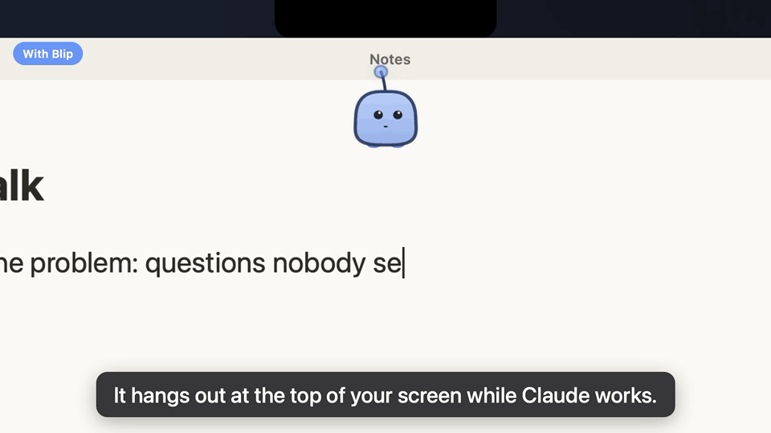

# Blip Notification

A small animated character, Sprout, at the top centre of your screen. It tells you when Claude Code is done, needs you, or hit an error, so you can look away while Claude works.

**Status:** early preview, Mac only. Windows and a one-click download are next.

## What it does

- **Working:** Sprout appears and reads along. After 20 seconds it shrinks into a glowing bulb.
- **Needs you:** it hops and waves, with the question or the tool underneath.
- **Done:** a bubble says "All done. Click me to open your session" and stays until you close it or click it. If you come back to the session's app, it closes after about 20 seconds of reading. Then Sprout peeks from the top edge until you have checked the result.
- **Error:** it droops and shows what went wrong.

Click Sprout to jump back to the session. Right-click it to hide or show the message text. Everywhere else your clicks pass straight through.

## Install

Open Claude Code in any folder and say:

> Install Blip by following https://github.com/Mohamed-Shahzan/blip-notification/blob/main/INSTALL.md

Claude tells you what it will run and asks before each step. To do it by hand, the same steps are in [INSTALL.md](INSTALL.md). It takes about 15 minutes, mostly the first build.

To uninstall: stop the app (press `Ctrl+C` in its Terminal window), run `claude plugin marketplace remove blip-notification`, and delete `~/blip-notification` and `~/.blip`.

## How it works

Claude Code hooks send each event to a small local app (Tauri and Rust) that draws Sprout in plain JavaScript on a canvas. The app listens on `127.0.0.1` only, and nothing leaves your Mac. If Blip is closed or frozen, Claude Code behaves exactly as if it did not exist.

## What we ran into

- **A frozen app must never slow Claude down.** The hooks run in the background, each gives up after 2 seconds, and none can block Claude.
- **Telling "done" from "you saw it".** Blip checks which app is in front and whether you are away, so you never miss a finish.
- **Quiet bugs found by testing again.** A Control-click on the Mac counted as a normal click.
- **Power.** A resting peek used about 12% of a CPU core. Sprout now holds still and sways every 30 seconds: about 2%.

Privacy: Claude's last reply is shown in the bubble and never saved. How each turn ended passes through small files in `~/.blip/inbox`, which the app deletes as soon as it reads them. Right-click Sprout to hide the message text.

Built with [Tauri](https://tauri.app), plain JavaScript and Claude Code hooks.

Blip and Sprout by Mohamed. Free to use, including at work. The code may not be copied into other projects, shared, sold or used for AI training. Suggested changes are welcome as pull requests. Pictures and videos of Sprout may be shared with credit (CC BY-ND 4.0). See [LICENSE](LICENSE).
