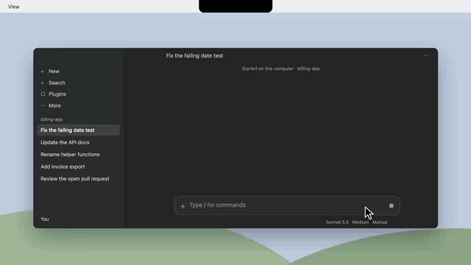

# Blip

A small animated character, Sprout, at the top centre of your screen. It tells you when Claude Code is done, needs you, or hit an error, so you can look away while Claude works.

**Status:** early preview. Works on Mac. Windows is next.

## What it does

- **Working:** Sprout appears and reads along.
- **Needs you:** it hops and waves, with the question underneath.
- **Done:** a bubble says "All done". Click it to jump back to your session.
- **Error:** it droops and shows what went wrong.

Everything stays on your computer.

## Install (Mac)

Open Claude Code in any folder and say:

> Install Blip by following https://github.com/Mohamed-Shahzan/blip-notification/blob/main/INSTALL.md

Claude explains each step and asks before it runs anything. It takes about 15 minutes, mostly the first build. To do it by hand, the same steps are in [INSTALL.md](INSTALL.md).

To uninstall: stop the app (press `Ctrl+C` in its Terminal window), run `claude plugin marketplace remove blip-notification`, then delete `~/blip-notification` and `~/.blip`.

Blip and Sprout by Mohamed. Free to use, including at work. The code may not be copied into other projects, shared, sold or used for AI training. Suggested changes are welcome as pull requests. Pictures and videos of Sprout may be shared with credit (CC BY-ND 4.0). See [LICENSE](LICENSE).
