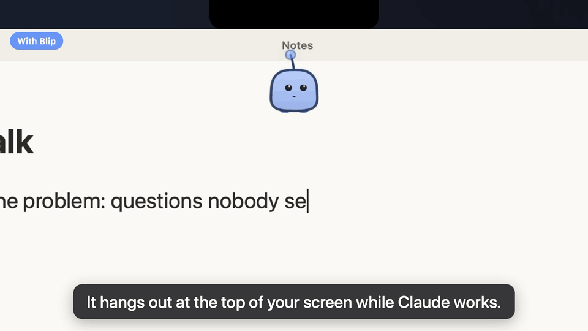

# Blip Notification

[](https://mohamed-shahzan.github.io/blip-notification/)

### 👉 [See it in action: try Sprout live in your browser](https://mohamed-shahzan.github.io/blip-notification/)

[](https://mohamed-shahzan.github.io/blip-notification/#video)

*[Watch the full 53-second demo with sound](https://mohamed-shahzan.github.io/blip-notification/#video). Voice by elevenlabs.io, music "Upbeat" by hitslab on Pixabay.*

A small animated character, Sprout, that sits at the top centre of your screen and tells you when Claude Code is done, needs you, or hit an error. You can look away while Claude works and Sprout calls you back.

**Status: early preview, Mac only.** Everything below works on the Mac today. Windows support, sounds and a one-click app download are coming next.

## What you will see

| When Claude Code is... | Sprout |
|---|---|
| Working | Appears at the top of the screen, reading along. After 20 seconds it says "This will take a while. I'll tell you when it's done." and shrinks into its glowing antenna bulb. Hover over the bulb to see Sprout again. |
| Waiting for you (a permission or a question) | Hops, waves and says "Over here! Claude needs you", with the question or the tool underneath. |
| Done | A happy hop and "All done!", with the first line of Claude's reply underneath. Then it hides. |
| Stopped by an error | Droops and says "Something went wrong", with the error underneath. |

Right-click Sprout to hide or show the message text under its line. Sprout only takes clicks on itself; everywhere else your clicks go straight through to the apps below.

## How it works

Blip has two parts:

1. **The Blip app**, which draws Sprout. It runs on your computer and listens on `127.0.0.1` only, so nothing leaves your machine.
2. **The Blip plugin for Claude Code**, which tells the app what Claude is doing.

You install both once, on your computer. They then work with every project you open in Claude Code, in the Terminal and in the Claude Desktop app. Nothing is added to your projects.

If the Blip app is closed, crashed or frozen, Claude Code behaves exactly as if Blip did not exist.

## Install (Mac)

### The easy way: let Claude Code do it

Open Claude Code in any folder and say:

> Install Blip by following https://github.com/Mohamed-Shahzan/blip-notification/blob/main/INSTALL.md

Claude reads [INSTALL.md](INSTALL.md), tells you what it will run, and asks before each step.

### By hand

You need about 15 minutes, most of it waiting for the first build.

**1. Install the tools Blip is built with** (skip any you already have)

- Apple's command line tools: `xcode-select --install`
- Rust: follow [rustup.rs](https://rustup.rs)
- Node.js 18 or later: [nodejs.org](https://nodejs.org)
- Claude Code: [claude.com/claude-code](https://claude.com/claude-code)

**2. Download Blip**

```bash
git clone https://github.com/Mohamed-Shahzan/blip-notification.git ~/blip-notification
```

**3. Build and start the Blip app**

```bash
cd ~/blip-notification/app && npm install && npm run tauri dev
```

The first build takes several minutes. Keep this Terminal window open: Blip runs as long as it does. Next time, only this last command is needed, and it starts in seconds.

**4. Connect Claude Code to Blip**

In a new Terminal window:

```bash
claude plugin marketplace add Mohamed-Shahzan/blip-notification
```

```bash
claude plugin install blip@blip-notification
```

**5. Try it**

Start a new Claude Code session (in the Desktop app, open a new session) and ask Claude anything. Sprout appears at the top of your screen while Claude works, and hops when it is done.

## Uninstall

1. Stop the Blip app: press `Ctrl+C` in its Terminal window.
2. Remove the plugin: `claude plugin marketplace remove blip-notification`
3. Delete the `~/blip-notification` folder and the `~/.blip` folder.

## Privacy

Blip only listens on `127.0.0.1`, so nothing leaves your Mac. Claude's last reply, question or error is shown in Sprout's bubble and is not saved anywhere. The plugin passes how each turn ended to the app through small files in `~/.blip/inbox`, which the app deletes as soon as it reads them. Right-click Sprout to hide the message text.

## Built with

[Tauri](https://tauri.app) (Rust) for the window and the state logic, plain JavaScript and canvas for Sprout, and Claude Code hooks for the events. Try every state in the [live playground](https://mohamed-shahzan.github.io/blip-notification/).

## License

MIT, see [LICENSE](LICENSE).
